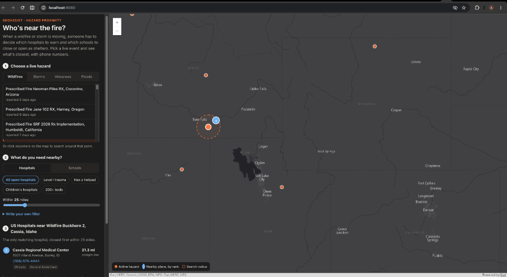

# GeoAssist Hazard Proximity (MCP)

**[Try the live map →](https://aashisho1o1.github.io/geoassist-mcp/)** No install, no sign-in. It opens on a real active US wildfire.

[](https://aashisho1o1.github.io/geoassist-mcp/)

When a wildfire or a severe storm is active, the first questions are usually simple ones. Which hospitals are close to it? Which schools might need to close or serve as shelters? Is there a trauma center with a helipad nearby?

The data to answer those questions is already public on ArcGIS Online, and NASA EONET already tracks the events. This MCP server connects the two, so anyone using Claude Desktop, Cursor, or another MCP client can ask in plain English and get a short list of nearby places, closest first, with phone numbers.

It grew out of two earlier projects of mine: a NASA EONET disaster monitor I built at Soka, and GeoAssist, a natural-language front end for ArcGIS Feature Services.

## The live map

The [demo](https://aashisho1o1.github.io/geoassist-mcp/) is a static page built with the ArcGIS Maps SDK for JavaScript. It calls NASA EONET and the public ArcGIS layers straight from the browser, and it runs the server's own compiled modules (`docs/lib/`, copied by `npm run build:demo`). The filter check, the distance search, and the hazard handling you see on the map are the same code an AI client reaches through MCP.

Things to try on it:

- Pick a fire, then **Level I trauma**. A card shows how many Level I hospitals an exact `TRAUMA = 'LEVEL I'` filter finds nationwide, and how many it misses.
- Open **Write your own filter** and try the typo, or the value that isn't in the layer. The typo is refused with "Did you mean 'TRAUMA'?", and the unknown value with a message that it is not one of the field's 60 values. Neither is sent to ArcGIS.
- Switch to **Schools → Has a shelter ID** to see which nearby schools have a shelter ID in the layer.
- Open **How this answer was made** to see the exact query, with a link that runs it in the ArcGIS REST API.

## What I found in the data

The hospital layer's `TRAUMA` field is free text with 60 distinct values. Level I alone is written 22 different ways: `LEVEL I`, `I`, `LEVEL 1`, `1`, `LEVEL I, PEDIATRIC I`, `PEDIATRIC LEVEL I`, `LEVEL I, PEDIACTRIC II` (a typo in the data), and more. When I checked on November 11, 2026, a filter for exactly `'LEVEL I'` found 123 hospitals marked open and Level I in the US, and missed 141.

Those numbers come from one rule for "Level I": any value containing a standalone `I` or `1`. That rule counts centers that are Level I for children only (`PEDIATRIC 1`, six spellings, 24 hospitals) as Level I. Leaving those out, 16 spellings name a Level I center for adults: 240 hospitals, of which the exact filter still misses 117. Both rules live in the server (`isLevelI` and `isAdultLevelI` in `src/datasets.ts`), are covered by the tests, and are what `get_dataset_schema` returns as the `LEVEL_I` and `LEVEL_I_ADULT` value groups on the `TRAUMA` field. The demo page uses the same lists. The rules read the text of the field. They are not a clinical judgment about what a hospital can treat.

A query like that doesn't fail. It returns a shorter list, and nothing tells the reader that most of the answers are missing. So the server now sends the model the full list of values for coded fields, and its tool description tells the model to match every spelling, not a single `LIKE` pattern.

## Tools

| Tool | What it does |
| --- | --- |
| `list_active_hazards` | Open US wildfires, severe storms, volcanoes, or floods from NASA EONET, newest first. |
| `get_dataset_schema` | Fields, types, and real example values for the hospitals, schools, or cities layer, plus who hosts the layer and when it was last edited. |
| `find_nearby` | Places within a radius of an EONET event or a lat/lon point, sorted by distance, with an optional filter. Returns the exact query sent to ArcGIS, the total number of matches inside the radius, and the data source. |

## How it is built, and why

The model proposes and the server decides. There is no LLM call inside this server. The AI client writes the filter, and plain TypeScript checks it against the live layer schema before anything reaches ArcGIS:

- every field name must exist in the layer (a typo like `TRAUMMA` comes back with "Did you mean 'TRAUMA'?")
- `;`, `--`, `/*` outside a quoted value, and any word that is not a field or a basic SQL keyword, are rejected
- for coded fields (hospitals: `STATUS`, `TRAUMA`, `HELIPAD`, `TYPE`, `OWNER`, `STATE`; schools: `LEVEL_`, `STATE`, `TYPE`, `STATUS`; cities: `CAPITAL`, `CLASS`, `STATE_ABBR`), a quoted value in `FIELD = '...'` must exist in the layer. `STATUS = 'OPENED'` comes back with "Did you mean 'OPEN'?". A suggestion is only made when one value is clearly the nearest: `TRAUMA = 'LEVEL ONE'` comes back with a plain "not a value of TRAUMA", because no value is near enough to guess. In an `IN (...)` list, values that don't exist are allowed as long as one does, and the answer names the ones that matched nothing
- a filter is only refused over a value when it can be shown to match nothing, which means every condition is joined by `AND`. With `OR` or `NOT` in the filter (`HELIPAD = 'YES' OR STATE = 'CA'`) the rest may still match, so the filter runs and the unknown value is named in the notes
- radius is capped at 100 miles and results at 25

I built it this way because a wrong answer here is worse than no answer. If the model guesses a field name, the old GeoAssist would quietly return an empty map, and someone might read that as "there is no hospital nearby." Here the guess is caught and the model gets a message it can fix.

A few other choices made with the person on the other end in mind:

- Name, address, and phone are always returned for hospitals and schools, even if the model forgets to ask for them. Hospitals also always return status, schools enrollment, and cities name, state, and population.
- Every answer carries the date the layer's data was last edited and a note about what the data is. For hospitals the note says to call ahead and that an emergency means calling 911.
- An empty result tells the model to widen the search before concluding nothing is there.
- Hospitals the layer marks as closed are left out by default (`STATUS = 'OPEN'`), since sending someone to a closed hospital is worse than a shorter list. The rule stays on unless the filter itself asks for another status (`STATUS = 'CLOSED'`, `STATUS <> 'OPEN'`) or the call sets `open_only: false`. Just naming the field (`STATUS IS NOT NULL`) does not switch it off. "Open" means marked open in an old snapshot, not open today.
- `get_dataset_schema` shows real values (for example `TRAUMA = 'LEVEL II'`), because one example teaches the format better than a description. For coded fields like `TRAUMA`, `HELIPAD`, and `STATUS` it lists every value in the layer.
- The schema is read from the live layer and kept for one hour. If a value list fails to load, that schema is not kept, so the next call tries again. Until it loads, the field is marked `values_unavailable` and any answer that filters on it says the value was not checked.
- A feature service returns at most its `maxRecordCount` rows per request (2,000 on these layers), in storage order rather than by distance. The server asks for that many. If a circle holds more, the rows returned would be an arbitrary subset, so the server searches for a smaller circle that fits under the cap and still holds enough results, then sorts by distance. If even that isn't possible, the answer says the list is not guaranteed to be the closest.
- `total_in_radius` is a separate count of every match inside the radius that was asked for, so "the 10 closest" is never mistaken for "all 10". If the count request fails it is `null`, not 0.
- `data_source` names the origin of the data, the account that hosts the layer, and the date the layer's data was last edited (the service's `dataLastEditDate`, read on first use and again whenever the schema is refreshed, about once an hour). The same date is repeated in the notes.
- Each result includes its latitude and longitude, so a client can put it on a map.

Because there is no LLM inside, there is also no API key to protect and no cost to run it. All three data sources are public.

## Data sources

| Dataset | Origin | Hosted on ArcGIS Online by | Data last edited (what the tool reports) | What the records describe |
| --- | --- | --- | --- | --- |
| Hospitals | HIFLD Hospitals | FEMA Region 6 GIS ([item](https://www.arcgis.com/home/item.html?id=38eebc0197034d59b331eaa7f753cdb0)) | August 30, 2021 | Newest source date inside the data: May 2018 |
| Public schools | HIFLD Public Schools, from NCES Common Core of Data | FEMA, account `FEMA_HQ_Preparedness_NIC` ([item](https://www.arcgis.com/home/item.html?id=963a2d204098495a8a80134ed9dc95ae)) | August 27, 2025 | The 2022-2023 school year (NCES Common Core of Data) |
| Major cities | Esri, US Census Bureau | Esri, ArcGIS Living Atlas ([item](https://www.arcgis.com/home/item.html?id=9df5e769bfe8412b8de36a2e618c7672)) | December 8, 2022 | 2020 Census population counts |

Dates are as checked on November 11, 2026. "Data last edited" is when rows last changed on the service, which is not the same as how current the records are: the hospital rows were last touched in 2021 but describe 2018 or earlier. The school and city services also report a later settings change (September 4, 2025 and May 20, 2026), which did not change the data.

Only the cities layer is a Living Atlas item. The hospital and school layers are copies of HIFLD data that FEMA accounts host publicly. They are not marked authoritative on ArcGIS Online, and their owners can change or remove them.

I looked for a current, authoritative replacement for hospitals. The Living Atlas layer "Hospitals Registered with Medicare" is newer, but it has no trauma level, helipad, bed count, or open/closed status, which are the fields this tool is about. So the tool keeps the HIFLD copy and says how old it is in every answer.

## The shared core

`src/core.ts` exports the parts that are not specific to MCP: the dataset list, the schema reader, the filter gate (`checkFilter`, `checkFields`, `checkOrderBy`), and the distance search. It uses no Node-only API. Three things import it:

- the MCP tools in `src/tools.ts`
- the live demo page (as `docs/lib/core.js`)
- the [GeoAssist](https://github.com/Aashisho1o1/GeoAssist) web app, which installs this repository as a dependency and imports `geoassist-hazard-proximity/core`

So the checks are written and tested once.

## Setup

Requires Node 20 or later.

```bash
npm install
npm run build
npm test
```

### Claude Desktop

Add this to `claude_desktop_config.json` (Settings, Developer, Edit Config), using the full path to this folder:

```json
{
  "mcpServers": {
    "geoassist": {
      "command": "node",
      "args": ["/full/path/to/geoassist-mcp/dist/index.js"]
    }
  }
}
```

Restart Claude Desktop and the three tools appear.

### Live map, locally

```bash
npm run build:demo
python3 -m http.server 8080 --directory docs
```

Then open http://localhost:8080. `build:demo` copies the compiled server modules into `docs/lib/`, so run it after changing anything in `src/`.

### MCP Inspector

To call the tools by hand without an AI client:

```bash
npm run inspect
```

## Things to try

- "What wildfires are active in the US right now?"
- "For the newest fire in California, which hospitals with a trauma center are within 30 miles?"
- "List public schools within 10 miles of that fire with enrollment over 1,000."
- "Which hospitals near 34.1, -117.7 have a helipad?"

## Limits

- EONET gives a point for each event, not a fire perimeter or storm footprint. Distances are straight-line miles from that point, not driving distance.
- The hospital layer is an old snapshot (see Data sources). A hospital it lists as open may have closed, and newer hospitals are missing. The default `STATUS = 'OPEN'` filter is only as good as that snapshot.
- The school layer is a snapshot too, not live status. About 3,600 of its 103,165 rows have a `STATUS` other than `1` (closed, inactive, or not yet open), and nothing filters them out.
- Coverage is the US only, since the layers used here are US datasets.
- The "in the US" test for hazards is a set of rough bounding boxes. Events just across the Canadian or Mexican border can appear in the list, and events in the Aleutians west of the date line are left out.
- Values are checked only for the coded fields listed above, and only in `=` and `IN` comparisons (including `'x' = FIELD` and `UPPER(FIELD) = 'x'`). `LIKE` patterns, ranges, `BETWEEN`, negated values, numbers, and other text fields (for example `CITY = 'Springfeld'`) are not checked, so a misspelled value there still returns nothing without an explanation.
- The gate checks words and characters, not grammar. `BEDS > 1 AND AND STATE = 'CA'` passes the gate and is rejected by ArcGIS with its own error.
- A polygon event is reduced to the average of its corner points, which is wrong for a shape that crosses the date line. EONET returned only points for the open events I checked.
- The value check ignores letter case and trailing spaces, because that is how these layers compare text (`STATUS = 'open'` matches `OPEN`). A layer that compares text exactly would need a stricter check.

## Tests

`npm test` runs the server end to end through a real MCP client with ArcGIS and EONET mocked, so it works offline. It covers distance sorting, the where gate, field suggestions, US filtering, polygon events, the open-only default, the full value lists for coded fields, the dense-area radius search, the data-source block, the total count, the value check (including `OR`, `NOT`, empty values, and a value list that failed to load), the two Level I rules, and schema cache expiry.

GitHub Actions runs the tests on every push and pull request, and fails if `docs/lib/` does not match what `npm run build:demo` produces from `src/`, or if a module the demo imports was not copied.
